
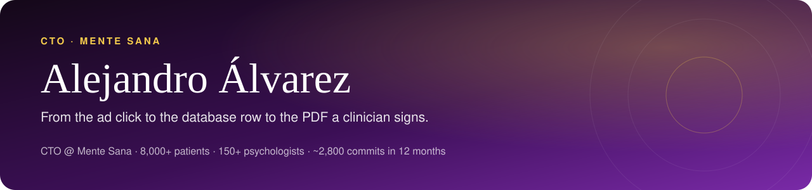

  

**Product Engineer, end to end.** I take a business problem, find the metric that matters, ship the product that moves it and measure whether it did — from the ad click to the database row to the PDF a clinician signs.

CTO at **[Mente Sana](https://mentesanapsicologia.com)**, an online psychology clinic in Spain: **8,000+ patients, 150+ licensed psychologists**. I build and run its whole product surface — acquisition funnel, payments, booking, CRM, clinical tooling, lifecycle messaging and the AI features around them.

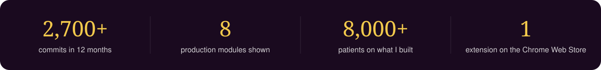

---

## Featured work — Mente Sana

<table>
  <tr>
    <td width="50%"><a href="https://github.com/AlejandroAlvarez-srdev/mentesana-diagnostic-funnel">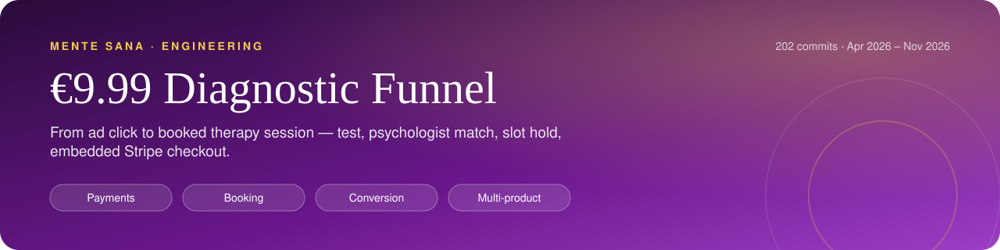</a></td>
    <td width="50%"><a href="https://github.com/AlejandroAlvarez-srdev/mentesana-growth-engine">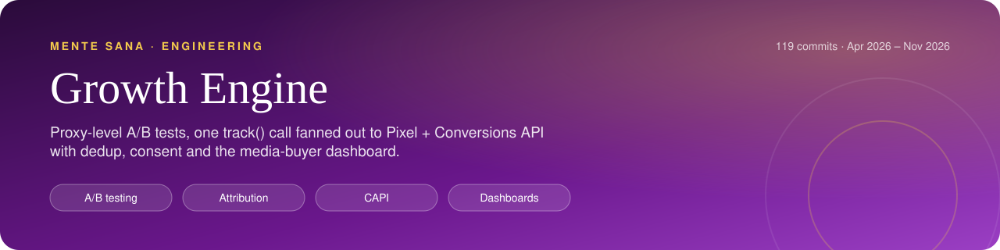</a></td>
  </tr>
  <tr>
    <td width="50%"><a href="https://github.com/AlejandroAlvarez-srdev/mentesana-agent-console">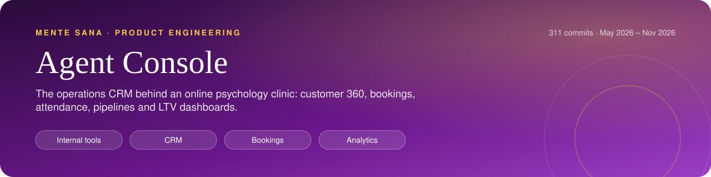</a></td>
    <td width="50%"><a href="https://github.com/AlejandroAlvarez-srdev/mentesana-ai-video-studio">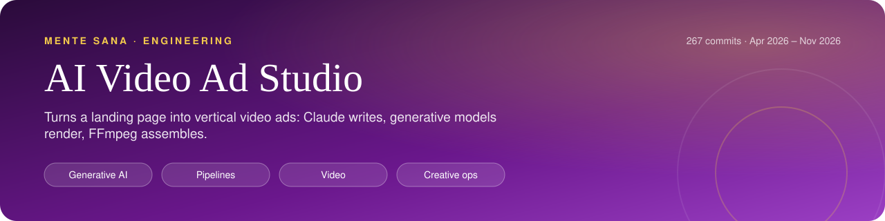</a></td>
  </tr>
  <tr>
    <td width="50%"><a href="https://github.com/AlejandroAlvarez-srdev/mentesana-whatsapp-inbox">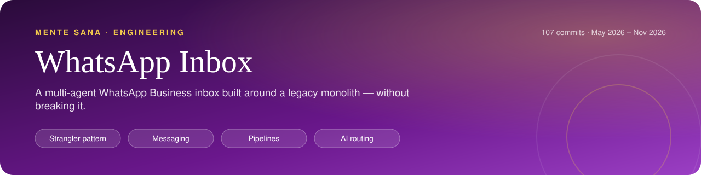</a></td>
    <td width="50%"><a href="https://github.com/AlejandroAlvarez-srdev/mentesana-clinical-reports">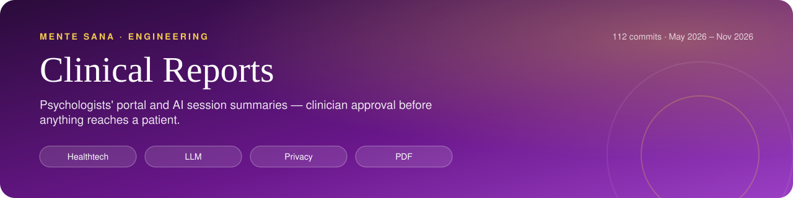</a></td>
  </tr>
  <tr>
    <td width="50%"><a href="https://github.com/AlejandroAlvarez-srdev/mentesana-lifecycle-emails">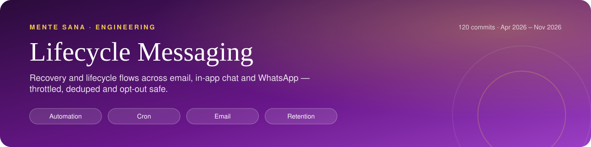</a></td>
    <td width="50%"><a href="https://github.com/AlejandroAlvarez-srdev/mentesana-meet-extension">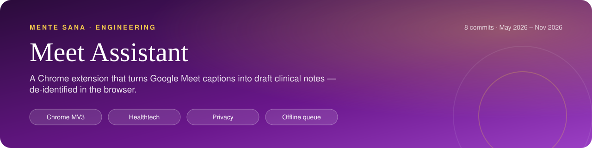</a></td>
  </tr>
</table>

Each repo below is a module extracted from the private production monorepo **with its real commit history preserved** (secrets and personal data removed), plus a case-study README: problem → what I built → architecture → trade-offs → impact.

| Repo | What it is | History |
|---|---|---|
| [**mentesana-diagnostic-funnel**](https://github.com/AlejandroAlvarez-srdev/mentesana-diagnostic-funnel) | The €9.99 acquisition funnel: landing → test → psychologist match → slot hold → embedded Stripe checkout → webhook booking. Parametrised so the same funnel launched speech therapy and nutrition as new products. | 200+ commits |
| [**mentesana-growth-engine**](https://github.com/AlejandroAlvarez-srdev/mentesana-growth-engine) | Sticky A/B tests at the proxy, one `track()` fanning out to Pixel + Conversions API with dedup, Consent Mode v2, attribution, and the media-buyer dashboard with an AI campaign analyst. | 110+ commits |
| [**mentesana-agent-console**](https://github.com/AlejandroAlvarez-srdev/mentesana-agent-console) | Operations console for sales & support: customer 360, bookings written transactionally into the booking system's MySQL, attendance, pipelines, cohort/LTV dashboards. | 300+ commits |
| [**mentesana-whatsapp-inbox**](https://github.com/AlejandroAlvarez-srdev/mentesana-whatsapp-inbox) | Multi-agent WhatsApp Business inbox built with a strangler-fig pattern around a legacy monolith — multiple numbers, routing, pipelines, templates, scheduled sends, AI routing & lead scoring. | 100+ commits |
| [**mentesana-clinical-reports**](https://github.com/AlejandroAlvarez-srdev/mentesana-clinical-reports) | Psychologists' portal and paid session summaries: LLM draft + clinical-risk alert, clinician approval before anything is sent, private PDFs, attendance certificates. | 110+ commits |
| [**mentesana-lifecycle-emails**](https://github.com/AlejandroAlvarez-srdev/mentesana-lifecycle-emails) | Lifecycle & recovery messaging: 41 cron routes, 56 templates, throttling / dedupe / opt-out across email, in-app chat and WhatsApp. | 110+ commits |
| [**mentesana-ai-video-studio**](https://github.com/AlejandroAlvarez-srdev/mentesana-ai-video-studio) | Turns a landing page into vertical video ads: Claude writes scripts and hooks, generative models render shots and voice, FFmpeg assembles. Idempotent, cron-driven job pipeline. | 260+ commits |
| [**mentesana-meet-extension**](https://github.com/AlejandroAlvarez-srdev/mentesana-meet-extension) | Manifest V3 Chrome extension ([Web Store](https://chromewebstore.google.com/detail/idiokgdfhladphbdfpkiedfboghkicfh)) that turns Google Meet captions into draft clinical notes, with in-browser de-identification and an offline queue. | — |

**Some results from this work:** a tracking gap where the browser pixel recorded 0 purchases was closed by moving purchases server-side with deterministic dedup · an A/B test of the landing CTA picked the winner on paid conversions (8 vs 3) · 85% of buyers attend their session and 57% buy a therapy bundle within 30 days · 97% of paid traffic is mobile, so every flow is designed phone-first.

## Products & client work

<table>
  <tr>
    <td width="50%"><a href="https://github.com/AlejandroAlvarez-srdev/adstack">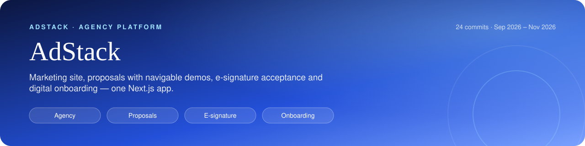</a></td>
    <td width="50%"><a href="https://github.com/AlejandroAlvarez-srdev/kairos-platform">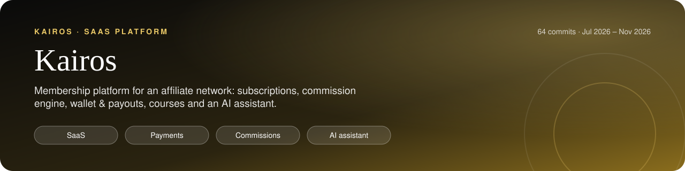</a></td>
  </tr>
</table>

| Repo | What it is |
|---|---|
| [**adstack**](https://github.com/AlejandroAlvarez-srdev/adstack) | My agency platform: marketing site, client proposals with navigable demos, e-signature acceptance stored in Supabase, server-saved digital onboarding. · [live](https://adstack-blue.vercel.app) |
| [**kairos-platform**](https://github.com/AlejandroAlvarez-srdev/kairos-platform) | Membership SaaS for an affiliate network: subscriptions, versioned commission engine with tests, wallet & payouts, courses, AI assistant. · [live](https://www.kairosnetwork.llc) |
| [**escala-cx**](https://github.com/AlejandroAlvarez-srdev/escala-cx) | Website + CRM + lead capture for a CX consultancy, seeded from AdStack's onboarding. |
| [**novara**](https://github.com/AlejandroAlvarez-srdev/novara) | Construction-group website with an interactive 3D architectural model (Three.js). · [live](https://novara-gules.vercel.app) |
| [**RTC-MicroSeviceLLM**](https://github.com/AlejandroAlvarez-srdev/RTC-MicroSeviceLLM) | Python LLM microservice (technical test). |

Also shipped (private): the Mente Sana mobile app (Expo / React Native, 580+ commits of my own), the B2B platform for companies, and a corporate site redesign for a construction company ([live](https://constructora-gya.vercel.app)).

## How I work

- **Start from the number.** Every feature has a metric and an event behind it before it ships.
- **Ship small, keep the old system running.** Strangler patterns, feature flags by cookie, idempotent jobs, dry-run modes.
- **Privacy is a feature.** Health data never leaves where it belongs: PII stripping before third parties, clinician approval gates, signed URLs.
- **AI where it earns its keep.** Classification, scoring, drafting and creative generation — always with a fallback and a human in the loop where it matters.

**Stack:** TypeScript · Next.js (App Router, v16) · React / React Native (Expo) · Node · Supabase / Postgres · MySQL · Redis · Stripe · Vercel · Meta Marketing & Conversions API · WhatsApp Cloud API · Anthropic / OpenAI / Replicate / fal · FFmpeg · Three.js / GSAP · Python
